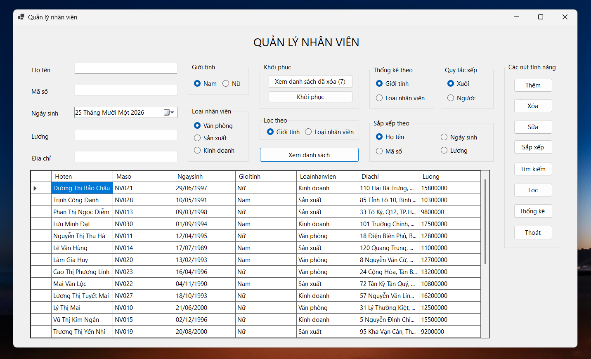

# Mẫu winform quản lý 

Mẫu winform C# dùng trong quản lý học sinh, sinh viên, nhân viên 
Gồm nhiều thành phần cơ bản cấu thành như:
- textbox
- button
- groupbox 
- radio button
- label
- datagridview 
- datetimepicker
- chart

## Tác giả
**Nguyễn Trường Chinh (NTC++)** 
**GitHub:** [https://github.com/trgchinhh](https://github.com/trgchinhh)

---

> 📌 Dự án nhỏ được phát triển với mục đích học tập và nghiên cứu. Mọi góp ý và đóng góp đều được hoan nghênh. Nếu thấy hữu ích thì cho mình xin 1 sao cho repo này !!! 
